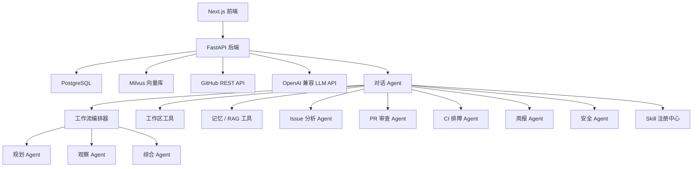

# 研伴 RepoPilot

研伴 RepoPilot 是一个面向 GitHub PR / Issue 研发协作的全栈 AI Agent 项目。系统会连接仓库数据，分析 Issue、PR diff、CI 日志、项目知识库和本地工作区代码，并返回结构化建议与安全的操作草稿。

## 核心能力

- 连接并同步 GitHub 仓库中的 Issue、Pull Request、PR 文件、Review 评论、Workflow Run、Job 和日志。
- Issue 分析：分类、优先级、复杂度、推荐负责人、重复候选和行动项。
- PR 审查：摘要、关键变更、风险点、检查清单、测试建议和需要重点关注的文件。
- CI 排障：失败类型、可能原因、排查步骤和相关上下文。
- Agent 对话：`ChatAgent` 使用原生工具调用，串联工作区、记忆、RAG、Issue、PR、CI、周报和安全工具。
- 多 Agent 工作流审查：`WorkflowOrchestrator` 构建 Planner -> 专用 Agent -> Observer -> Synthesis 的闭环，用于 PR 就绪度、阻塞项、优先级和跨领域工程决策。
- Skill Runtime：按用户显式指定或触发条件选择 `SKILL.md`，只向当前任务加载完整指令与受限资源；显式 Skill 校验允许工具，多 Agent 中的专用 Agent 分别加载自己的 Skill，并把版本、激活原因、指令摘要和执行校验写入 trace。
- 工作区代码工具：安全地列出文件、读取文件和搜索本地代码。
- RAG 聚焦 Issue 描述、PR 说明与 Review 评论、失败 CI 日志、项目文档、上传知识和已批准的长期记忆；当前代码走工作区/词法检索，团队与实时状态走结构化查询。
- 生成工程周报。
- 基础 Eval 覆盖 Issue 分类、PR 覆盖度、RAG 命中率、工具 schema 就绪度和结构化输出校验。

## 技术栈

- 后端：Python、FastAPI、Pydantic、SQLAlchemy、PostgreSQL、Milvus、httpx、LangChain。
- Agent 编排：原生工具调用 + 专用分析 Agent。
- 前端：Next.js、TypeScript、Tailwind CSS。
- 基础设施：Docker Compose 与 `.env` 配置。

## 架构

上下文与记忆的完整调用链、六层实现对照和 Python 阅读说明见 [上下文与记忆阅读指南](docs/architecture/context-memory-guide.md)。



## 快速开始

```bash
cp .env.example .env
docker compose build minio
docker compose up -d postgres etcd minio milvus

cd backend
python -m venv .venv
.venv\Scripts\activate
pip install -r requirements.txt
uvicorn app.main:app --reload
```

另开一个终端：

```bash
cd frontend
npm install
npm run dev
```

默认地址：

- 后端：http://localhost:8000
- API 文档：http://localhost:8000/docs
- 前端：http://localhost:3000

### 登录与账号隔离

首次打开前端会显示管理员初始化页面，没有默认账号或默认密码。开发环境可从本机创建第一个账号；远程初始化或 `APP_ENV=production` 时，必须先在服务端配置随机的 `AUTH_BOOTSTRAP_TOKEN`，再在页面输入该密钥。用户名不区分大小写，密码至少 12 个字符。

升级旧数据库后，首次初始化沿用旧演示用户的 ID，并将已有仓库、会话、知识库、评测和工作区归属初始化管理员；原数据不删除。其他账号只能看到自己的仓库和派生数据。初始化管理员在右上角账号设置页创建用户、选择角色；普通 `owner` 也只能管理自己的项目。自助注册默认关闭，显式设置 `AUTH_ALLOW_REGISTRATION=true` 后新注册用户的角色固定为 `developer`。

浏览器使用 HttpOnly 会话 Cookie，退出登录会撤销服务端会话，修改密码会撤销该账号其他会话。账号设置页提供登录会话管理（查看设备/踢出会话），初始化管理员可查看用户列表并重置任意账号密码（重置后目标账号全部会话立即失效）。`DEMO_MODE` 仅控制演示数据，不跳过登录或权限检查。私有仓库 Token 必须通过当前账号的仓库连接表单提供，不再回退使用全局 `GITHUB_TOKEN`。服务器本地目录、自定义下载目录和自定义 GitHub API 地址仅允许初始化管理员配置。

生产环境使用 HTTPS，设置 `APP_ENV=production`、精确的 `CORS_ORIGINS`，并使前端和 API 使用相同主机名（可用反向代理 `/api`）；不同端口可用，完全不同的域名不适用当前 Cookie/CSRF 方案。生产模式下必须设置随机 `TOKEN_ENCRYPTION_KEY`，否则后端拒绝启动。反向代理部署时需配置 `TRUSTED_PROXIES=loopback`（或代理 IP 列表），登录 IP 限流才能按真实客户端地址生效。Cookie 默认 30 天过期，可用 `AUTH_SESSION_HOURS` 调整（上限 2160 小时即 90 天）。聊天与 RAGAS 评测接口默认每用户每分钟 60 次（`LLM_REQUEST_RATE_LIMIT_PER_MINUTE`，0 关闭）。日志默认文本格式，可设 `LOG_FORMAT=json` 输出结构化日志；每个请求的日志和响应头 `X-Request-ID` 使用同一 ID，审计表同步落库，便于排障串联。接口和脚本调用示例、迁移说明及角色边界见 [安全说明](docs/architecture/security.md)。

### 本地 MinIO 镜像

MinIO 社区版已改为仅发布源码，旧的 `minio/minio:latest` 镜像不可用。本项目使用 `scripts/minio/Dockerfile` 从官方固定提交 `9e49d5e7a648f00e26f2246f4dc28e6b07f8c84a` 构建 `RELEASE.2025-10-15T17-29-55Z`，Go 和 Debian 基础镜像也固定了摘要。该社区版本已停止维护，仅用于本地验证；生产部署应重新评估维护状态、安全更新和 AGPLv3 许可要求。

首次启动需要先执行 `docker compose build minio`；之后使用本地镜像，不会从 Docker Hub 拉取 MinIO。当前 Windows 主机的代理端口为 `7897`，构建步骤需要联网时可使用：

```powershell
$env:HTTP_PROXY = "http://127.0.0.1:7897"
$env:HTTPS_PROXY = "http://127.0.0.1:7897"
docker compose build --build-arg HTTP_PROXY=http://host.docker.internal:7897 --build-arg HTTPS_PROXY=http://host.docker.internal:7897 --build-arg NO_PROXY=localhost,127.0.0.1 minio
docker compose up -d --no-build --wait --wait-timeout 180 postgres etcd minio milvus
```

MinIO 管理页面为 `http://127.0.0.1:9001`，默认开发账号和密码都是 `minioadmin`，可通过 `MINIO_ACCESS_KEY`、`MINIO_SECRET_KEY` 更改。MinIO 和 Milvus 的主机端口仅监听本机，数据分别保存到 `devflow_minio_data`、`devflow_milvus_data` 命名卷；当前 Docker Desktop 的数据虚拟磁盘位于 `D:\BrowserDownload\DockerInstall\DockerData`。不要使用 `docker compose down -v`，除非明确要删除数据库数据。

容器启动成功不会自动将 `start_rag.ps1` 的 SQLite 演示模式切换到 PostgreSQL/Milvus，也不会安装 Qwen 本地 Embedding 模型。完整应用仍需配置 `DATABASE_URL`、`MILVUS_ENABLED=true` 并准备可用的 Embedding 提供方。

### Windows 完整本地环境

系统环境变量 `AI_API_KEY`、`AI_BASE_URL`、`AI_MODEL` 分别控制 AI 密钥、接口地址和聊天模型，优先于兼容的 `LLM_*` 配置。纯域名地址自动补 `/v1`，已有自定义接口路径保持不变。密钥不写入项目配置或启动日志；RAG 生成和默认 Ragas Judge 复用同一模型配置。

本地 Embedding 单独使用官方 `Qwen/Qwen3-Embedding-0.6B`，不使用聊天模型的 API。首次准备依赖与模型：

```powershell
$env:HTTP_PROXY = "http://127.0.0.1:7897"
$env:HTTPS_PROXY = "http://127.0.0.1:7897"
.\backend\.venv\Scripts\python.exe -m pip install torch --index-url https://download.pytorch.org/whl/cpu
.\backend\.venv\Scripts\python.exe -m pip install -r backend/requirements-local-embedding.txt
.\backend\.venv\Scripts\python.exe scripts/prepare_embedding.py
```

本机上述准备已完成。之后在项目根目录启动：

```powershell
.\scripts\start_local.ps1 -ProxyUrl http://127.0.0.1:7897
```

脚本等待四个 Docker 依赖服务就绪，检查离线 Qwen 缓存，然后启动本机前端 `http://127.0.0.1:3000` 与后端 `http://127.0.0.1:8000`。使用 PostgreSQL + Milvus + CPU Qwen 1024 维向量，不导入假仓库，也不修改原有 SQLite 演示数据库。模型固定到官方提交 `97b0c614be4d77ee51c0cef4e5f07c00f9eb65b3`，缓存、上传文件、日志、进程记录和持久化本地 Token 加密密钥均保存在项目 `.data` 目录（D 盘）。离线加载模型不需要 API key 或 Hugging Face 登录。

停止前后端使用 `.\scripts\stop_local.ps1`，不会停止 Docker 或删除数据库。端口已占用时启动脚本会明确报错，不会终止未知进程。修改 AI 系统环境变量后应重新启动前后端；必要时重新打开终端以刷新环境变量。

GitHub 仓库需要在页面连接真实仓库，私有仓库需要相应权限的 Token；当前禁用自动同步，避免未配置仓库时触发后台请求。仓库接入页提供同步健康面板：查看最近每次同步的触发来源、处理/跳过条数、失败原因，并可实时查询该仓库 Token 的 GitHub API 限流余量。删除仓库为软删除，保留期内可在“已删除仓库”中恢复或彻底清理（`REPO_SOFT_DELETE_RETENTION_HOURS`，默认 7 天）。Qwen API 重排是另一项可选服务，需要百炼密钥和 `RERANK_BASE_URL`；没有配置时使用本地启发式重排，并在状态中显示实际模式。它不影响本地 Qwen Embedding 与 Milvus 向量检索。

## RAG 知识问答系统

项目内置了与第 7.1 节流程一一对应的完整 RAG 系统：知识库创建向导、文档解析、段落感知切片、Embedding、向量/关键词混合检索、重排、召回测试、问答工作室、上下文组装、基于证据生成和编号引用。支持 TXT、Markdown、PDF、DOCX、JSON、CSV 与日志文件；重复文件会按 SHA-256 跳过。

对话链路采用混合 RAG：`ContextAssembler` 会在调用 ChatAgent 前按原始问题检索并注入证据；进入推理循环后，模型仍可把 `rag.search_similar_documents` 当作工具，改写查询、连续补查不同资料，并根据多次工具结果交叉验证答案。

项目不会把所有私域数据都向量化。只有需要跨来源语义召回、会反复使用的非结构化知识进入 RAG；源码与配置以当前 checkout 为准，优先通过 `workspace.search_code` 和 `workspace.read_file` 检索；Issue、PR、CI 的状态字段、团队成员和周报等结构化或派生数据直接查数据库/API。RAG 返回的是候选证据，涉及实时状态和当前代码时仍要回到权威数据源核验。

CI 历史失败日志在召回时会直接核对 `workflow_runs` 的最新已同步状态，无需等待向量索引重建。同仓库、工作流、分支、事件及 PR 范围后续已通过时，旧日志会标为历史参考；同一运行重跑成功会清除业务表中的旧日志，重建索引时移除该失败文档。聊天、工作流和 PR 审查使用各范围最新运行判断失败信号，历史失败不能单独证明当前阻塞。成功日志仍不向量化。升级后重启后端（自动补齐字段），并重新同步仓库以补充工作流、分支、提交和重跑次数；未补齐的旧记录会提示范围未知。状态以最近一次同步为准，要获取 GitHub 最新结果需先同步仓库。

从旧版本升级后，请对每个知识库调用一次 `POST /api/rag/{repo_id}/reindex`。重建会按新边界清理历史向量和旧会话 Document；只部署代码不会主动删除已有索引。

如果只想先验证页面、结构化数据和无模型兜底回答，Windows 本地可以用下面的脚本启动 SQLite 演示环境：

```powershell
.\scripts\start_rag.ps1
```

脚本会关闭 Milvus，使用 deterministic embedding 和启发式重排，并停用演示知识库的 `0.8` 分数阈值，避免只有关键词分支时全部候选都被过滤。因此它可以验证页面、上传解析、关系库存储、Hybrid 的关键词分支和引用展示，但向量检索状态会明确显示 `degraded`，不能用来证明完整 RAG 已经跑通。要验证向量召回、混合检索和重建索引，仍需先按“快速开始”启动 PostgreSQL、etcd、MinIO 和 Milvus。

知识库默认选择 `Qwen/Qwen3-Embedding-0.6B` 与 `qwen3-rerank`。安装 `backend/requirements-local-embedding.txt` 后可运行本地 Qwen Embedding；配置 `DASHSCOPE_API_KEY`、`RERANK_BASE_URL` 后可切换百炼 `text-embedding-v4` 与 `qwen3-rerank`。默认 Embedding 依赖缺失时系统会明确报错，不会在生产配置下静默改用另一套向量空间；只有上面的本地演示脚本会显式选择 deterministic embedding。已经配置 `LLM_API_KEY` 时，可用 `.\scripts\start_rag.ps1 -UseConfiguredLLM` 启用模型生成。

RAG API：

```text
POST /api/rag/knowledge-bases
GET  /api/rag/knowledge-bases
GET  /api/rag/knowledge-bases/{repo_id}
POST /api/rag/knowledge-bases/{repo_id}/documents
POST /api/rag/knowledge-bases/{repo_id}/retrieval-tests
GET  /api/rag/{repo_id}/status
POST /api/rag/{repo_id}/search
POST /api/rag/{repo_id}/ask
POST /api/rag/{repo_id}/reindex
```

## ChatAgent RAGAS 评测

启动主应用后打开 `http://127.0.0.1:3000/evals`，选择仓库、固定评测集和 Top-K，再点击“运行固定 RAGAS 评测”。评测会在隔离会话中真实运行生产 ChatAgent 和工具集，收集预检索与 Agent 二次检索证据，然后使用 Ragas 0.4 Collections API 计算 Context Precision、Context Recall、Faithfulness、Answer Relevancy 和 Agent Goal Accuracy。结果会保存评测集 Hash、阈值、逐题工具轨迹、检索证据、硬规则与失败诊断，便于对同一基线做回归。

默认 Judge 复用 `LLM_API_KEY`、`LLM_BASE_URL` 和 `LLM_MODEL`；也可以通过 `.env` 中的 `RAGAS_JUDGE_API_KEY`、`RAGAS_JUDGE_BASE_URL`、`RAGAS_JUDGE_MODEL` 单独配置。`docs/datas/evals/wardrobe_rag_cases.json` 提供 14 道基于已上传技术文档的固定题，仅适用于 `ice-ice01/wardrobeAgent`；维护者需复核后用于正式发布。系统会检查引用文档是否已进入当前仓库知识库，来源版本与导入说明见 [评测集说明](docs/datas/evals/README.md)：

```http
POST /api/evals/rag/run
Content-Type: application/json

{
  "repo_id": "<repository-uuid>",
  "run_judge": true,
  "top_k": 5,
  "suite_id": "wardrobe-tool-calling-rag-baseline-v1"
}
```

提交接口会立即返回 `queued` 状态和 `eval_id`，ChatAgent 与 RAGAS 在后台继续运行。通过 `GET /api/evals/{eval_id}` 轮询 `result.progress`；状态变为 `passed`、`failed`、`error` 或 `no_cases` 时结束。网页会自动轮询，刷新或离开页面不会中断已经提交的任务。

整体通过要求硬规则全部满足，并且五项语义指标都达到 `.env` 中对应的 `RAGAS_*_MIN` 门槛。页面把“执行状态”和“质量状态”分开显示：低分是质量失败；Judge 调用失败或指标缺失是评测不完整，不能伪装成质量结论。

固定题分别保存参考事实 `reference` 和任务验收要求 `reference_outcome`，允许同义表达及有证据支持的补充；这些内容只给评分器，不注入 ChatAgent。自动文档冒烟测试使用资料摘录，仅供链路诊断，不能作为发布基线。没有源码 checkout 时不向模型暴露不可用的 workspace 工具，文档问答仍可使用已入库知识。

`RAGAS_TIMEOUT_SECONDS` 默认 120 秒，限制单次 Judge HTTP 请求；`RAGAS_METRIC_TIMEOUT_SECONDS` 默认 360 秒，限制包含多步调用的完整指标。`RAGAS_METRIC_CONCURRENCY` 默认 2，限制同时运行的指标数。页面保存可用的 Judge 理由和分轮检索诊断；部分评分会显示已评分数量，不冒充完整通过。新评分口径为 `ragas-outcome-v2`，旧结果仅重评分时保留原题和原口径，建立新基线需完整重跑。

评测失败后可以直接在同一页面继续处理：

- 展开 Case 查看实际回答、参考答案、检索来源、工具轨迹和可执行诊断；
- 对 Judge 超时或缺失指标点击“仅重试异常评分”，复用已经保存的回答和证据，不重新运行 ChatAgent；
- 选择同仓库、相同非空评测集 Hash、Ragas/Judge 配置、评分口径和 Top-K 的结果做回归对比；
- 生成 `create_issue` 类型的 ActionDraft，把失败 Case、证据和建议带入人工确认流程，不会直接写入 GitHub。
